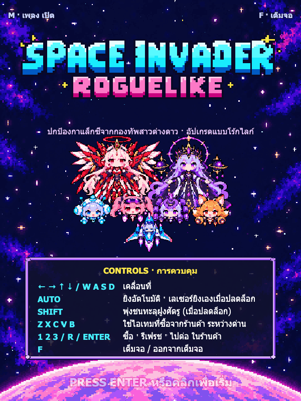
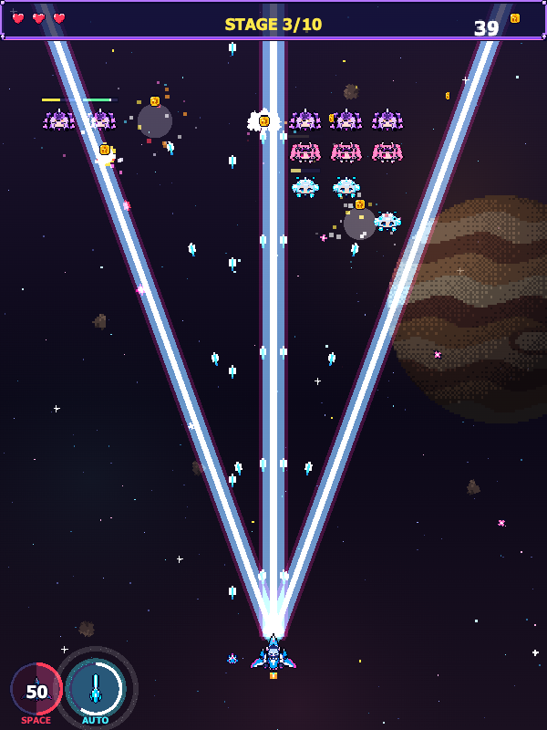
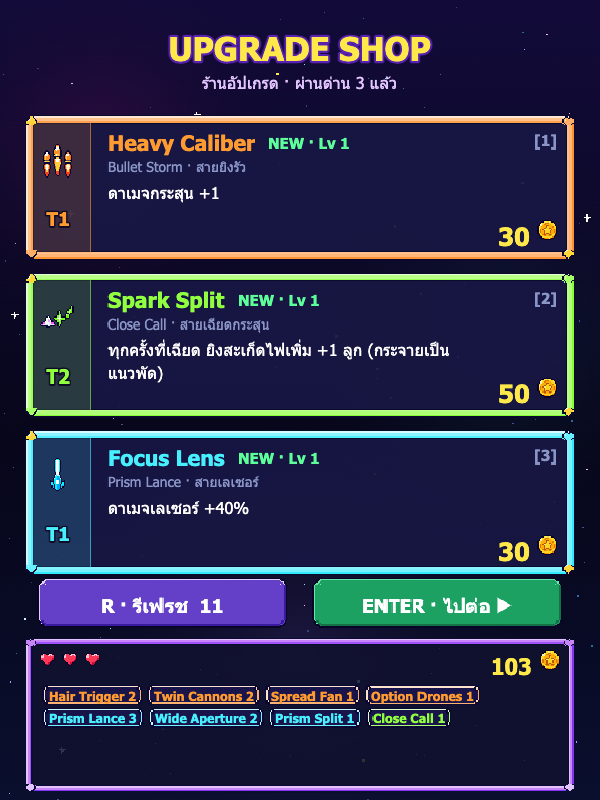
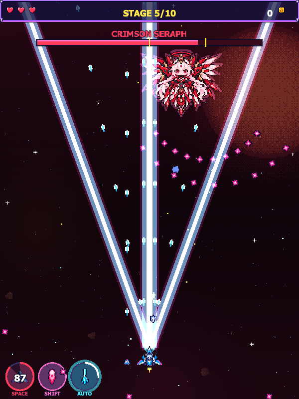

# Space Invader Roguelike

เกมยิงยานอวกาศแนว Space Invaders ผสมโร้กไลก์ ภาพพิกเซลอาร์ต เพลงแนว chiptune เล่นบนเบราว์เซอร์ได้ทั้งคอมพิวเตอร์และมือถือ ผู้เล่นต้องผ่าน 10 ด่าน สู้บอส 2 ตัว และอัปเกรดยานจากร้านค้าระหว่างด่าน แต่ละรอบจะได้ build ไม่ซ้ำกัน

**เล่นได้ที่ https://space-invader-rougelike.netlify.app/**

<p align="center">
  
  
</p>
<p align="center">
  
  
</p>

## วิธีเล่น

ยานยิงเองตลอดเวลา ผู้เล่นมีหน้าที่หลบกระสุน เก็บเหรียญ และเลือกอัปเกรด

| ปุ่ม | การทำงาน |
| --- | --- |
| `←` `→` `↑` `↓` หรือ `W` `A` `S` `D` | เคลื่อนที่ |
| `Space` | เปิด TRANS-AM เมื่อเกจเต็ม |
| `Shift` | พุ่งชนทะลุฝูงศัตรู เมื่อปลดล็อก Afterburner Dash แล้ว |
| `Z` `X` `C` `V` `B` | ใช้ไอเทมที่ซื้อมา ระหว่างอยู่ในด่าน |
| `1` `2` `3` | ซื้อการ์ดในร้านค้า |
| `R` | รีเฟรชการ์ดในร้านค้า |
| `Enter` | เริ่มเกม ไปด่านต่อไป หรือเล่นใหม่ |
| `M` | เปิดหรือปิดเพลง |
| `F` | เต็มจอ |

บนมือถือ ให้ลากนิ้วตรงไหนบนจอก็ได้เพื่อบังคับยาน แล้วแตะไอคอนด้านล่างจอเพื่อใช้ TRANS-AM, พุ่งชน และไอเทม

## ระบบในเกม

- **ด่าน.** มีทั้งหมด 10 ด่าน ด่าน 5 เป็นบอส Crimson Seraph และด่าน 10 เป็นบอส Void Empress บอสทั้งสองตัวมีร่างที่สอง พร้อมท่าพิเศษที่ต้องชาร์จก่อนปล่อย
- **ร้านค้า.** ก่อนออกบินและหลังจบทุกด่าน จะได้เลือกซื้อการ์ดเพิร์กหรือไอเทมด้วยเหรียญที่เก็บมา ราคาเพิ่ม 20% ทุกครั้งที่ผ่านด่าน
- **เพิร์ก 50 แบบ.** แบ่งเป็น 5 สาย
  - Bullet Storm (สายยิงรัว)
  - Prism Lance (สายเลเซอร์)
  - Comet Strike (สายพุ่งชน)
  - Close Call (สายเฉียดกระสุน)
  - Spirit Call (สาย Summoner)

  สายที่ลงเลเวลไว้จะมีโอกาสออกในร้านบ่อยขึ้น ทำให้ build ชัดขึ้นเรื่อยๆ ตารางเพิร์ก ไอเทม และด่านแบบเต็มอยู่ใน [docs/PERKS.md](docs/PERKS.md)
- **ไอเทม.** ซื้อเก็บไว้ใช้ทีหลังได้ มี Repair Kit, Nitro, Power Cell, Overclock และ Barrier Capsule
- **TRANS-AM.** เกจจะเต็มขึ้นเมื่อเฉียดกระสุน ฆ่าศัตรู หรือทำดาเมจใส่บอส และจะลดลงทุกครั้งที่โดนยิง เมื่อเปิดใช้ ยานจะยิงเร็วขึ้นสองเท่า บินเร็วขึ้น กระสุนทะลุศัตรูได้เพิ่ม 1 ตัว และกระสุนของศัตรูช้าลงครึ่งหนึ่ง เป็นเวลา 6 วินาที หลังจากนั้นยานจะอ่อนแรงลงอีก 4 วินาที

## พัฒนาต่อ

ต้องมี Node.js กับ npm

```bash
npm ci          # ติดตั้ง dependency
npm run dev     # เปิด dev server ของ Vite
npm test        # รันเทสต์ด้วย Vitest
npm run build   # เช็ก type แล้ว build ไปไว้ที่ dist/
npm run docs    # สร้าง docs/PERKS.md ใหม่จากโค้ด
```

เกมเขียนด้วย TypeScript บน [Phaser 4](https://phaser.io/) และ build ด้วย Vite ทุกเสียงทั้งเพลงและเอฟเฟกต์สังเคราะห์สดด้วย Web Audio ยกเว้นเพลงของ Void Empress เสียงพากย์ TRANS-AM และเสียง Newtype flash ซึ่งเป็นไฟล์เสียง

| โฟลเดอร์ | เก็บอะไร |
| --- | --- |
| `src/core/` | กติกาเกมที่ไม่ผูกกับ Phaser ได้แก่ ด่าน เพิร์ก ไอเทม ค่าสเตตัสยาน และ TRANS-AM |
| `src/game/` | สิ่งที่เกิดขึ้นในด่าน ได้แก่ ยาน ปืน เลเซอร์ ศัตรู บอส และรูปแบบกระสุน |
| `src/scenes/` | ฉากต่างๆ ของ Phaser ได้แก่ Title, Stage, Shop และ End |
| `src/audio/` | ตัวสังเคราะห์เพลง โน้ตเพลงของแต่ละด่าน และเสียงเอฟเฟกต์ |
| `src/art/`, `src/assets/` | สไปรต์ พาเลตสี และภาพ UI |
| `.claude/skills/verify-space-invader/` | สคริปต์ Playwright ที่เปิดเกมใน Chrome จริง แล้วเล่นตามสถานการณ์ต่างๆ เพื่อตรวจว่าแต่ละฟีเจอร์ทำงานถูก |
